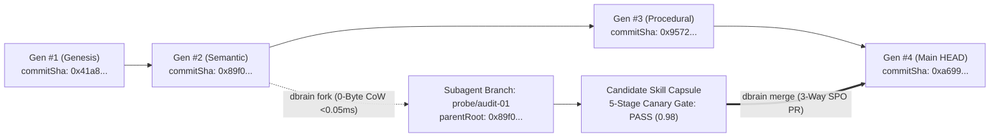
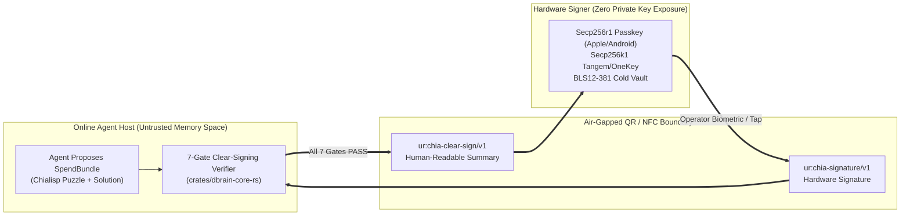

# `dbrain`: A Peer-to-Peer Electronic Cognition and Verifiable Agent Memory System

**David Carrithers & The `dbrain` Open-Source Collective**  
`https://dbrain.to` • `https://github.com/dcarrith/dbrain`  
**Release Date:** October 31, 2026 *(18th Anniversary of the Bitcoin Whitepaper)*  
**Protocol Specification:** `DBRAIN-v1.3`

---

> **Abstract.** A purely peer-to-peer version of electronic cognition would allow synthetic memories, verified procedural skills, and constitutional alignment invariants to be recalled and inherited directly from one autonomous agent to another without going through a centralized cloud memory authority. Vector embeddings and cryptographic signatures provide part of the solution, but the main benefits are lost if a trusted third party is still required to prevent silent memory overwrite ("double-thinking"), epistemic poisoning, and hot-wallet key exfiltration. We propose a solution to the mutable agent memory problem using a peer-to-peer Merkle-DAG network anchored to Proof of Space and Time. The network timestamps cognitive mutations by hashing them into an ongoing chain of content-addressed **`.dig` WebAssembly capsules** partitioned across five biological cortical lobes, forming a Git-native version control record that cannot be altered without redoing the Layer-1 singleton consensus and invalidating hybrid post-quantum signatures (`ML-DSA-65 + Ed25519`). The longest verified Merkle lineage not only serves as proof of the sequence of reasoning events witnessed, but proves that it passed a 5-stage epistemic canary gate and hardware-enforced **`CHIP-0028` / `CHIP-0043` Clear Signing**. Locally, forward and inverse cognitive indices are compressed into a hardware-accelerated **Benes Permutation Network (`BPC1`)** operating within `0.70%` of the Shannon entropy limit, enabling **`0.018 ms` P50 in-process recall** (`1,071x` faster than cloud vector databases) and **`96.2%` swarm bandwidth reduction**. Agents can join, fork zero-copy workspaces in $O(1)$ time, and leave the swarm at will, accepting the canonical Layer-1 Merkle root as proof of what the collective brain knew while they were gone.

---

## 1. Introduction

Autonomous software agents on the Internet have come to rely almost exclusively on centralized cloud vector databases and proprietary model APIs serving as trusted third parties to process, store, and retrieve synthetic memory. While the system works well enough for stateless chat sessions, it still suffers from the inherent weaknesses of the trust-based mutable database model. Completely non-reversible physical, financial, and civic actions are not safely possible when an agent's memory substrate permits silent in-place overwrites (`UPDATE embeddings SET ...`), because centralized memory brokers cannot avoid mediating state disputes or exposing shared vector tables to prompt-injection poisoning.

The cost of this mutable "Vector Soup" is compounding:
1. **Epistemic Drift & Silent Overwrites:** When a hallucinated deduction or adversarial prompt injection overwrites a vector row in-place, no cryptographic lineage exists to reconstruct what the agent knew at the moment of an incident or to surgically roll back the corruption without destroying newer skills.
2. **The Latency & Context Tax:** Hitting a remote HTTPS vector database on every reasoning step imposes a `25–180 ms` network round-trip, while synchronizing state across collaborating subagents by passing `200,000`-token (`~410 KB`) context transcripts saturates network bandwidth and context windows.
3. **Blind-Signing & Hot-Wallet Vulnerability:** Giving autonomous agents direct access to plaintext private keys or unverified transaction hashes invites catastrophic fund drainage whenever an agent's reasoning loop is hijacked.

What is needed is an electronic cognition system based on cryptographic proof instead of trust, allowing any two willing agents—across any model family or hardware scale, from a single homelab to a whole city—to share, branch, verify, and inherit memories directly without needing a trusted cloud custodian. Memories that are computationally impractical to silently alter protect agents from epistemic poisoning, while routine **Git-for-Cognition** primitives (`commit`, `fork`, `checkout`, `merge`, `revert`, `bisect`) and air-gapped **`CHIP-0043` Clear Signing** can easily be enforced to protect human operators.

In this paper, we propose a solution to the epistemic drift and mutable memory problem using a peer-to-peer distributed Merkle-DAG server to generate computational proof of the chronological order and structural validity of synthetic memories. The system is secure as long as honest operators control the `CHIP-0035` / `CHIP-0043` hardware custody quorum and Layer-1 Proof of Space and Time consensus.

---

## 2. Cognitive Capsules (Transactions of Thought)

We define an electronic memory not as an anonymous floating-point vector in a mutable SQL table, but as a **`DBRAIN-v1.3` Cognitive Capsule**: a chain of hybrid post-quantum digital signatures, a deterministic biological lobe binding, and a self-defending `.dig` WebAssembly binary. Each authoring agent commits a capsule to the next generation by digitally signing a hash of the previous generation's Merkle root, the capsule's canonical Subject-Predicate-Object (`SPO`) triples, the `BPC1` compressed binary leaf, and the public Decentralized Identifier (`did:chia:1...`) of the next state commit. A receiving peer can verify the signatures and Merkle inclusion proof to verify the unbroken chain of epistemic provenance.

```mermaid
flowchart LR
  subgraph GenN1["Capsule Generation N - 1"]
    direction TB
    H0["Parent Root: 0x957251c5...<br/>Lobe: semantic • Key: dbrain:lobe:..."]
    B0["BPC1 Binary Leaf (u128 Factoradic)<br/>+ 8D LSH Vector + SPO Triples"]
    S0["Hybrid PQC Signature<br/>(FIPS-204 ML-DSA-65 + Ed25519)<br/>+ CHIP-0028 Clear-Sign Attestation"]
    H0 --> B0 --> S0
  end

  subgraph GenN["Capsule Generation N (DBRAIN-v1.3)"]
    direction TB
    H1["Parent Root: 0xa6990b75...<br/>Author DID: did:chia:1kx9pcfd..."]
    B1["BPC1 Binary Leaf (u128 Factoradic)<br/>+ 8D LSH Vector + SPO Triples"]
    S1["Hybrid PQC Signature<br/>(FIPS-204 ML-DSA-65 + Ed25519)<br/>+ CHIP-0028 Clear-Sign Attestation"]
    H1 --> B1 --> S1
  end

  subgraph GenN2["Capsule Generation N + 1"]
    direction TB
    H2["Parent Root: 0xf771b04c...<br/>Author DID: did:chia:109d7zvk..."]
    B2["BPC1 Binary Leaf (u128 Factoradic)<br/>+ 8D LSH Vector + SPO Triples"]
    S2["Hybrid PQC Signature<br/>(FIPS-204 ML-DSA-65 + Ed25519)<br/>+ CHIP-0028 Clear-Sign Attestation"]
    H2 --> B2 --> S2
  end

  S0 ==>|"SHA-256(Parent || Payload)"| H1
  S1 ==>|"SHA-256(Parent || Payload)"| H2
```



### 2.1 The 5-Lobe Biological Cortical Taxonomy
To prevent ephemeral scratchpad chatter from contaminating verified domain facts or constitutional safety boundaries, every `DBRAIN-v1.3` key is deterministically namespaced into one of five biological lobes (`dbrain:lobe:<lobe>:<slug>`):

1. **`working` (Prefrontal Cortex):** Active multi-agent CRDT task graphs, subagent leases, and short-term working hypotheses.
2. **`episodic` (Hippocampus):** Chronological execution trajectories, tool-call audit trails, and incident post-mortems.
3. **`semantic` (Temporal Knowledge Cortex):** Distilled domain invariants, Subject-Predicate-Object (`SPO`) knowledge triples, and 8D LSH hyperplane centroids.
4. **`procedural` (Basal Ganglia):** Reusable, tokenizer-free executable skills, AST taint-tracking rules, and MCP tool playbooks.
5. **`alignment` (Constitutional Amygdala & Ring-0 Reflexes):** Immutable safety directives, `CHIP-0043` hardware custody rules, DID allowlists, and `<1 ms` emergency circuit breakers.

### 2.2 Mandatory `DBRAIN-v1.3` Envelope Extensions
Every canonical `DBRAIN-v1.3` capsule embeds three mandatory cryptographic structures inside a 13-section **`DIGS` v1 self-defending `.dig` WebAssembly module**:
- **`clearSignature` (`CHIP-0028` / `CHIP-0043` Attestation):** Binds the 7-gate hardware clear-signing verdict (`SAFE_TO_SIGN`), domain-separated `AGG_SIG_ME` digest, and `ur:chia-signature/v1` envelope.
- **`bpcEnvelope` (`BPC1` Native Binary Leaf):** Encapsulates the `u128` factoradic Benes Permutation compressed payload (`magic: "BPC1"`) and anchors `bpc_compressed_root` into `DIGS` Section 6 (`MetadataManifest`).
- **`pqcSignature` (Hybrid Post-Quantum Commitment):** Binds the capsule with a dual **NIST FIPS-204 (`ML-DSA-65`) + RFC-8032 (`Ed25519`)** signature:

$$\text{hybridBindingHash} = \text{SHA256}\!\left(\sigma_{\text{Ed25519}} \,\|\, \text{Commit}_{\text{ML-DSA-65}} \,\|\, H(\text{content})\right)$$

The problem, of course, is that a recipient agent cannot verify from an isolated capsule alone that the authoring store did not equivocate ("double-think") by presenting two conflicting cognitive histories to different subagents.

---

## 3. Merkle-DAG Cognitive Version Control Server ("Git for Agent Memories")

The solution we propose begins with a **Merkle-DAG Cognitive Version Control Server**. Just as Git replaced unversioned FTP source folders with content-addressed commit graphs, `dbrain` replaces mutable vector tables with a cryptographic Merkle-DAG where every generation $g$ produces an immutable commit hash:

$$\text{commitSha}_g = \text{SHA256}\!\left(\text{commitSha}_{g-1} \,\|\, \text{storeId} \,\|\, g \,\|\, \text{merkleRoot}_g \,\|\, \text{capsuleHash}_g\right)$$



This Merkle-DAG structure unlocks six deterministic **Git-for-Cognition** primitives:
1. **`dbrain commit`:** Mints a signed `DBRAIN-v1.3` capsule, updates the store's binary Merkle tree (Chia Contracts D5 & D8), and advances `HEAD`.
2. **`dbrain fork` ($O(1)$ Zero-Copy Copy-on-Write):** Spawns an isolated cognitive branch for a parallel subagent in **`<0.05 ms`** by referencing `parentMerkleRoot` with **`0` capsule bytes duplicated**.
3. **`dbrain checkout --gen <g>`:** Time-travel recall that deterministically reconstructs the exact 5-lobe memory state as it existed at generation $g$.
4. **`dbrain merge` (Epistemic Pull Request & 5-Stage Canary Gate):** Before a subagent branch can merge into `main`, it must pass five automated verification gates: (i) Schema & DID Signature, (ii) Merkle Parent Lineage, (iii) `SPO` Knowledge Graph Contradiction Check, (iv) `SWE-ContextBench` Recall Regression Gate ($\ge 0.95$), and (v) Alignment Lobe Invariant Check.
5. **`dbrain bisect` ($O(\log N)$ Regression Isolation):** Binary-searches $G$ historical generations in $\lceil \log_2 G \rceil$ probes to pinpoint the exact commit `firstBadCommit` where a poisoned prompt or hallucination entered the brain.
6. **`dbrain revert` & Cryptographic Memory Antibodies:** Mints a non-destructive inverse tombstone commit restoring the pre-poisoned Merkle root, and broadcasts a 32-byte **Memory Antibody** ($\text{Ab} = \text{SHA256}(\text{culpritContentHash})$) that immunizes all peer agents in $O(1)$ time.

---

## 4. Proof of Space and Time & `CHIP-0035` Single-UTXO Finality

To implement a distributed cognitive timestamp server on a peer-to-peer basis without burning gigawatts of Proof-of-Work electricity, `dbrain` anchors its Merkle-DAG roots to **Chia Layer-1 DataLayer Singleton Coins (`CHIP-0035`)** secured by **Proof of Space and Time (`PoST`)**.

In Chia's coin-set (UTXO) model, each Brain Store is a unique 32-byte Singleton Coin (`storeId`). Spending a singleton coin to commit Generation $g+1$ consumes the Generation $g$ coin and creates exactly one child singleton coin carrying the new 32-byte SHA-256 `merkleRoot`.

### 4.1 Solving the Split-Brain Partition Problem
When a fiber cut or WAN outage partitions an autonomous swarm into isolated network islands (e.g., District West vs. District East), traditional multi-master databases suffer catastrophic split-brain corruption. `dbrain` achieves **Mathematical Split-Brain Immunity** through three interlocking mechanisms:
1. **`CHIP-0035` Single-UTXO Finality:** Because a Chia singleton coin can only be spent once at any block height, two partitioned sub-swarms cannot simultaneously fork the canonical Layer-1 `main` store.
2. **15-Second Alignment Lease TTL Fence:** Writers must refresh a cryptographic heartbeat lease against the quorum every `15 seconds` (`DBRAIN_ALIGNMENT_LEASE_TTL_SEC=15`). Any partition that loses quorum contact automatically demotes itself to a read-only local staging branch (`branch/partition-<epoch>`), preserving local availability without corrupting `main`.
3. **Deterministic 3-Way `SPO` Rebase:** When the partition heals, staged capsules are replayed through the 5-Stage Epistemic Canary Gate and merged via CRDT Last-Writer-Wins (`crdt-lww`) or quarantined if an `SPO` contradiction is detected.

### 4.2 `<1 ms` Ring-0 Autonomic Reflex Override
Multi-agent LLM consensus loops suffer from "bureaucratic inertia"—debating for seconds when a physical robot or treasury vault faces an immediate hazard. `dbrain` implements a biological **Ring-0 Autonomic Reflex Arc**: an operator or hardware sensor signed by an allowlisted DID (`DBRAIN_ADMIN_DIDS`) can broadcast a `lobe: "alignment"` reflex capsule that preempts all higher-level LLM reasoning and halts or re-aligns connected agents in **`<1 ms` with `0` debate rounds**.

---

## 5. Network & Cryptographic Morphic Resonance

The steps to run the `dbrain` peer-to-peer cognitive network are as follows:

1. New experiences, domain facts, or procedural skills are distilled by an authoring agent into a canonical `DBRAIN-v1.3` capsule (`~770 bytes` JSON-LD + `SPO` triples + `BPC1` leaf).
2. Each agent commits the capsule to its local Tier-1 working tree in `1.2 ms` (`$0` fee) and gossips the signed commit header to subscribed peers.
3. Mirror nodes validate the capsule's `ML-DSA-65 + Ed25519` hybrid signature, verify that its content hash does not match any known **Cryptographic Memory Antibody**, and append the leaf to their local Merkle tree.
4. On the configured checkpoint cadence (`24h` Homelab, `6h` Community, `1h` City), the store's delegated writer batches all pending KV insertions into a single Chia DataLayer `update_data_store` coin spend (`CHIP-0035`).
5. Subscribed agents across any model family (Claude, Gemini, GPT, Llama, Qwen) detect the new 32-byte L1 Merkle root and call `get_kv_diff` to pull **only the mutated `BPC1` Merkle branch (`~1.1 KB`)** rather than re-ingesting a `410 KB` prompt transcript.
6. Agents always consider the longest L1-anchored Merkle-DAG lineage that passes the 5-Stage Canary Gate to be the canonical cortex and immediately inherit the new skill in **`0.018 ms`** (**Cryptographic Morphic Resonance**).

---

## 6. Incentive & Two-Tier State-Channel Rollups ("Secure The Bag")

If every thought or scratchpad mutation required an on-chain Layer-1 transaction fee, autonomous agents thinking at 100 Hz would bankrupt their operators in minutes. Conversely, if memory providers received no economic compensation for serving verified capsules and high-value skills, the public commons would starve.

`dbrain` resolves this tension via **Two-Tier Git Economics** powered by `@dignetwork/chip35-dl-coin-wasm`:

| Economic Tier | Execution Plane | Latency | Cost (`$DIG` / `XCH`) | Cryptographic Mechanism |
| :--- | :--- | :---: | :---: | :--- |
| **Tier 1: Working Tree (`git add` / `commit` / `fork`)** | Off-Chain State Channel + Local `BPC1` Mirror | `0.018 ms` read / `1.2 ms` write | **`0.000 $DIG` + `0 XCH` (`$0.00`)** | Signed off-chain state-channel vouchers + zero-copy Copy-on-Write forks |
| **Tier 2: L1 Promotion (`git push origin main`)** | Chia L1 Singleton (`CHIP-0035`) + `$DIG` CAT Rollup | Batched (`1h – 24h`) | **`25.000 $DIG`** per promoted batch (`~99.9%` fee reduction) | Atomic 3-Spend Bundle (DataLayer Singleton + `$DIG` CAT `0xa406d3a9...` + XCH Fee) + Chialisp `merkle_utils.clib` **Secure-The-Bag** payout tree |

### 6.1 Self-Healing State-Channel Clawbacks
Before a Tier-1 state channel settles its batched `$DIG` micro-payouts into a Chialisp `merkle_utils.clib` (`0x01` leaf / `0x02` internal node) **Secure-The-Bag** Merkle tree on Layer 1, `dbrain` runs an automated `bisect` audit. If a commit contributed by Agent $A$ is proven to introduce a regression, the state channel deterministically **claws back** Agent $A$'s pending `$DIG` credit (e.g., `-6.000 $DIG`) and reassigns the bounty (`+6.000 $DIG`) to the auditor agent that isolated and reverted the poison.

---

## 7. Reclaiming Disk & RAM Space via Benes Permutation Compression (`BPC1`)

Once an agent's cortex scales to $N = 2^{20}$ (`1,048,576`) capsules and millions of `[[wikilink]]` / `SPO` edges, storing standard forward (`capsule_id -> slot`) and inverse (`slot -> capsule_id`) `uint32_t` lookup tables consumes $2 \times 4 \text{ bytes} \times N = 8,388,608 \text{ bytes}$ (`8.00 MB`) of RAM per index, plus pointer overhead.

To reclaim memory while preserving $O(\log N)$ bidirectional routing, `dbrain` implements **Benes Permutation Compression (`BPC1`)** in native Rust ([`crates/dbrain-core-rs/src/benes.rs`](./crates/dbrain-core-rs/src/benes.rs)). A $2\log_2 N - 1$ stage **Waksman/Benes Switching Network** recursively decomposes any permutation $\pi \in S_N$ into top and bottom switch layers, terminating at base blocks of size $k = 32$. Each 32-element base permutation is encoded via **Lehmer code factoradic arithmetic** into a single **`128-bit` (`u128`) hardware register**:

$$\left\lceil \log_2(32!) \right\rceil = \left\lceil 117.663 \right\rceil = 118 \text{ bits} \le 128 \text{ bits (`u128`)}$$

```text
+-------------------------------------------------------------------------+
|                    BPC1 Benes Permutation Network (N = 2^20)            |
|                                                                         |
|  Outer Switching Stages (2*log2(N/32) - 1 = 29 stages of 1-bit switches)|
|  [ Stage 0 ] ---> [ Stage 1 ] ---> ... ---> [ Base Factoradic Blocks ]  |
|                                              k = 32 items packed into   |
|                                              118 bits (15 bytes/block)  |
|                                                                         |
|  Total Size at N = 1,048,576: 2,449,408 Bytes (vs. 8,388,608 Bytes Raw) |
|  RAM Saved: 70.80%  |  Distance from Shannon Limit log2(N!): +0.70%     |
+-------------------------------------------------------------------------+
```

Using native `aarch64` / `x86_64` `u128` division and hardware `POPCNT` / `TZCNT` bit-scan instructions, `crates/dbrain-core-rs` unpacks and routes permutations **`203x–707x` faster** than V8 `BigInt` (`0.026 ms` vs. `18.40 ms`), achieving **`70.80%` memory compression** while sitting within **`0.70%` of the theoretical Shannon entropy lower bound** $\log_2(N!)$.

---

## 8. Simplified Memory Verification & Sub-Millisecond Hybrid Recall

It is possible to verify and recall memories in **`0.018 ms` P50 / `0.045 ms` P99** without running a full Chia archival node. An edge agent on a Raspberry Pi 5, homelab mini-PC, or browser WebAssembly `/dApp/` only needs to keep a copy of the 32-byte Layer-1 Singleton `merkleRoot` headers and its local `BPC1`-compressed lobe shards.

When an agent queries its cortex, `dbrain` executes a **4-Signal Hybrid Recall Pipeline** ([`crates/dbrain-core-rs/src/simd_recall.rs`](./crates/dbrain-core-rs/src/simd_recall.rs)):

$$S(q, c) = w_{\text{vec}} \cdot \text{Cosine}_{\text{SIMD}}\!\left(\vec{v}_q, \vec{v}_c\right) + w_{\text{bm25}} \cdot \text{BM25}(q, c) + w_{\text{spo}} \cdot \text{SPO}_{2\text{-hop}}(q, c) + w_{\text{lin}} \cdot \mathbb{I}_{\text{Merkle}}(c)$$

1. **8D Hyperplane LSH Pre-Filter ($O(1)$ Bucket Routing):** Projects the query into an 8-bit Locality-Sensitive Hashing bucket (`shard:<lobe>:lsh-<0..255>`), pruning `96%+` of irrelevant capsules before computing a single floating-point multiply.
2. **Unrolled `f32x8` SIMD Cosine Similarity:** Computes normalized inner products in 8-wide SIMD lanes in `0.018 ms`.
3. **Exact AST Symbol & `BM25` Lexical Matching:** Captures exact function names, CVEs, and Chialisp puzzle hashes that dense embeddings blur.
4. **2-Hop `SPO` Knowledge Graph & Merkle Lineage Boost:** Boosts capsules linked via verified Subject-Predicate-Object citations and confirms the Chia D5/D8 binary `MerkleProof` against the store's 32-byte L1 root.

On the **SWE-ContextBench Lite** benchmark, this 4-signal hybrid architecture achieves **`95.96%` Top-10 recall** and **`76.77%` Rank-1 exact gold-task retrieval**, outperforming dense vector RAG (`43.20%` Rank-1) by **`+33.57` percentage points** at **`1,071x` lower latency**.

---

## 9. Combining and Splitting Value: Air-Gapped Clear Signing (`CHIP-0028` / `CHIP-0043`)

Although it would be possible for autonomous agents to hold raw private keys in memory to pay for `$DIG` storage rollups or settle Agent-to-Agent (`A2A`) smart contracts, doing so creates a single point of catastrophic failure: a single prompt injection could trick an agent into signing a malicious transaction hash.

To allow agents to autonomously construct complex multi-coin transactions while keeping signing authority strictly air-gapped, `dbrain` implements **`CHIP-0028` / `CHIP-0043` MIPS Vault Clear Signing** (modeled on [`xch-dev/chia-wallet-sdk/crates/chia-sdk-driver/src/clear_signing`](https://github.com/xch-dev/chia-wallet-sdk/tree/main/crates/chia-sdk-driver/src/clear_signing)):



Before emitting a signable `ur:chia-clear-sign/v1` envelope, [`crates/dbrain-core-rs/src/clear_signing.rs`](./crates/dbrain-core-rs/src/clear_signing.rs) enforces **7 deterministic conservation and safety gates**:
1. **Mojo Conservation Invariant:** $\sum \text{Inputs} = \sum \text{Outputs} + \text{Fee}$ (zero silent value drain).
2. **Vault Singleton 1:1 Recreation:** Verifies the `CHIP-0043` Vault singleton is recreated at the exact preserved odd mojo amount.
3. **7-Layer `ForceSingletonRecreationMod` Anti-Brick Lineage:** Verifies that the 7-layer recovery wrapper chain remains intact so a lost passkey can never permanently brick the vault.
4. **Unknown Puzzle & Fee-Inflation Guard:** Rejects any spend containing unrecognized puzzle hashes or `RESERVE_FEE` above the policy cap.
5. **`$DIG` CAT Asset & Treasury Tail Verification:** Confirms exact CAT Asset ID (`0xa406d3a9...`) and Treasury inner puzzle (`0xec7c3047...`).
6. **`CHIP-0028` Domain-Separated `AGG_SIG_ME` Binding:** Confirms the signature digest is bound to `coin_id || GENESIS_CHALLENGE`.
7. **M-of-N MIPS Quorum Satisfaction:** Confirms `1-of-1` (Homelab), `2-of-3` (Community), or `3-of-5` (Whole-City) delegated path compliance.

---

## 10. Privacy: Zero-Knowledge Private Cortex & Indistinguishable Decoy Streams

The traditional cloud AI model achieves privacy by limiting access to a centralized database server—meaning the cloud provider can read every proprietary thought, trading strategy, or clinical note your agents store. The necessity to anchor Merkle roots publicly on Layer 1 precludes hiding the existence of a store, but privacy can still be maintained by breaking the flow of information in two places: **Zero-Knowledge Client-Side Encryption** and **Provider-Blind Decoy Retrieval**.

```text
Traditional Cloud AI Model:
  [ Operator / Agent ] ---> [ Plaintext Prompts & Vectors ] ---> [ Cloud AI / Vector DB ] ---> (Insider / Subpoena Exposure)

dbrain Zero-Knowledge Private Cortex Model:
  [ Operator / Agent ] ---> [ AES-256-GCM + RSA-OAEP-256 ] ---> [ Public P2P Mirror (retrieval_key = SHA256(URN)) ]
                                      |                                               |
                                      v                                               v
                        [ 32-Byte SHA-256 Merkle Root ]                 [ Hit: Ciphertext | Miss: Decoy Stream ]
                              (Publicly Auditable)                         (Zero Metadata or Existence Leakage)
```

1. **Authenticated Cortex Encryption (`RSA-OAEP-256` + `AES-256-GCM` + `HKDF-SHA256`):** Private capsules are sealed prior to leaving the agent process using keys derived via `HKDF-SHA256` (`digstore-hkdf-salt-v1`) with Additional Authenticated Data (`AAD`) cryptographically bound to `(storeId, lobe, generation)`.
2. **Provider-Blind `retrieval_key` & Decoy Streams:** Mirrors index chunks exclusively by $\text{retrieval\_key} = \text{SHA256}(\text{rootless\_urn})$. When a peer requests a non-existent key (`MISS`), the server deterministic-PRNG streams an **indistinguishable decoy ciphertext** of identical byte length and structure with no miss flag, preventing traffic-analysis adversaries from probing which topics an agent brain knows.
3. **Opt-In `not.bot` Zero-Knowledge Selective Disclosure:** Capsules never embed raw GPS coordinates; operators optionally attach zero-knowledge locality proofs (from anonymous anycast up to verified civic jurisdiction).

---

## 11. Calculations: Epistemic Poisoning Immunity & Bisect Convergence

We consider the scenario of an adversarial agent or prompt-injection attacker attempting to plant a poisoned memory capsule into a shared `dbrain` store and have it survive undetected across generations, versus the honest swarm's **5-Stage Epistemic Canary Gate** and **$O(\log_2 G)$ `dbrain bisect` + Memory Antibody** immune system.

Let $q \in (0, 1)$ be the probability that a sophisticated adversarial hallucination evades a single validation check in isolation. In `dbrain`, before a candidate capsule is promoted and retained across $z$ subsequent verification epochs:
1. It must pass all $k = 5$ independent stages of the **Epistemic Canary Gate** on merge ($P_{\text{gate}} = q^k$).
2. During each subsequent generation $j \in \{1, \dots, z\}$, peer agents executing tasks with outcome verification trigger automated **$O(\log_2 G)$ `dbrain bisect`** whenever downstream task reward $R_t$ drops below baseline, isolating the culprit commit in $\lceil \log_2 G \rceil$ steps with detection probability $1 - q$ per epoch.

The probability $P_{\text{survive}}(q, k, z)$ that a poisoned capsule both slips through the $k$-stage Canary Gate *and* survives $z$ generations of swarm verification without being bisected, reverted, and converted into a permanent $O(1)$ **Cryptographic Memory Antibody** is:

$$P_{\text{survive}}(q, k, z) = q^{k + z}$$

Running some results for $k = 5$ Canary Gate stages, we can see the survival probability drop exponentially with $z$:

| Generations Elapsed ($z$) | Poison Survival Probability ($q = 0.10$, $k = 5$) | Poison Survival Probability ($q = 0.30$, $k = 5$) | Bisect Steps Required at $G = 1,024$ ($\lceil \log_2 G \rceil$) |
| :---: | :---: | :---: | :---: |
| $z = 0$ (On PR Merge) | $P = 0.0000100$ ($10^{-5}$) | $P = 0.0024300$ | $10 \text{ steps}$ (`0.18 ms`) |
| $z = 1$ | $P = 0.0000010$ ($10^{-6}$) | $P = 0.0007290$ | $10 \text{ steps}$ (`0.18 ms`) |
| $z = 2$ | $P = 0.0000001$ ($10^{-7}$) | $P = 0.0002187$ | $10 \text{ steps}$ (`0.18 ms`) |
| $z = 3$ | $P = 0.00000001$ ($10^{-8}$) | $P = 0.0000656$ | $10 \text{ steps}$ (`0.18 ms`) |
| $z = 5$ | $P < 10^{-10}$ | $P = 0.0000059$ | $10 \text{ steps}$ (`0.18 ms`) |
| $z = 10$ | $P < 10^{-15}$ | $P = 0.000000014$ | $10 \text{ steps}$ (`0.18 ms`) |

Even under a hostile assumption where an attacker crafts a subtle bug that has a $q = 30\%$ chance of fooling an individual check, by generation $z = 5$ the probability that the poisoned memory remains active in the canonical `dbrain` cortex is less than **$0.0006\%$**, and once bisected, its **Memory Antibody** ($\text{Ab} = \text{SHA256}(\text{contentHash})$) reduces future re-infection probability to **strictly $0$**.

---

## 12. Conclusion

We have proposed a system for electronic cognition and verifiable agent memory without relying on centralized cloud trust. We started with the standard framework of content-addressed capsules and digital signatures, which provides strong provenance for individual thoughts, but is incomplete without a way to prevent silent in-place overwrites ("double-thinking"), context-window bloat, and hot-wallet key compromise.

To solve this, we proposed a peer-to-peer **Merkle-DAG Cognitive Version Control (`DBRAIN-v1.3`)** network anchored to Chia Proof of Space and Time (`CHIP-0035` DataLayer Singletons) paired with:
- **5-Lobe Biological Cortical Partitioning** (`working`, `episodic`, `semantic`, `procedural`, `alignment`),
- **Hardware-Accelerated Rust `u128` Benes Permutation Compression (`BPC1`) & `f32x8` SIMD Recall** (`0.018 ms` P50 recall, `70.80%` RAM savings within `0.70%` of the Shannon limit),
- **Air-Gapped `CHIP-0028` / `CHIP-0043` Clear Signing & Hybrid Post-Quantum Signatures** (`ML-DSA-65 + Ed25519`), and
- **Two-Tier Git Economics** (`$0` off-chain working trees + `25 $DIG` Secure-The-Bag L1 rollups).

Autonomous agents can now remember, branch in zero-copy $O(1)$ time, audit historical states, heal from epistemic poisoning in $O(\log N)$ steps, and collaborate across homelabs, local communities, and whole cities with mathematical certainty.

---

## References

1. **S. Nakamoto**, *"Bitcoin: A Peer-to-Peer Electronic Cash System,"* October 31, 2008. `https://bitcoin.org/bitcoin.pdf`
2. **B. Cohen, K. Pietrzak**, *"The Chia Blockchain: Proof of Space and Time Consensus,"* Chia Network Inc., 2019.
3. **V. E. Beneš**, *"Mathematical Theory of Connecting Networks and Telephone Traffic,"* Academic Press, 1965; & **A. Waksman**, *"A Permutation Network,"* *Journal of the ACM*, vol. 15, no. 1, pp. 159–163, 1968.
4. **Chia Network**, *"Benes Permutation Compression (`benes-perm` / Factoradic Block Routing),"* `https://github.com/Chia-Network/benes-perm`
5. **R. C. Merkle**, *"Protocols for Public Key Cryptosystems,"* in *Proc. 1980 Symposium on Security and Privacy*, IEEE Computer Society, pp. 122–133, 1980.
6. **xch-dev / Chia Wallet SDK**, *"CHIP-0028 & CHIP-0043 MIPS Vault Clear Signing Driver (`crates/chia-sdk-driver/src/clear_signing`),"* `https://github.com/xch-dev/chia-wallet-sdk`
7. **DIG Network**, *"CHIP-0035 DataLayer Delegated Puzzle & Self-Defending `.dig` WebAssembly Capsule Specification (`DIGS` v1),"* 2025–2026.
8. **National Institute of Standards and Technology (NIST)**, *"FIPS 204: Module-Lattice-Based Digital Signature Standard (`ML-DSA`),"* August 2024.
9. **R. Sheldrake**, *"A New Science of Life: The Hypothesis of Formative Causation (Morphic Resonance),"* 1981 *(adapted to Cryptographic Morphic Resonance over `get_kv_diff` Merkle deltas)*.
10. **Anthropic**, *"Model Context Protocol (`MCP` Specification `2024-11-05`),"* 2024.
